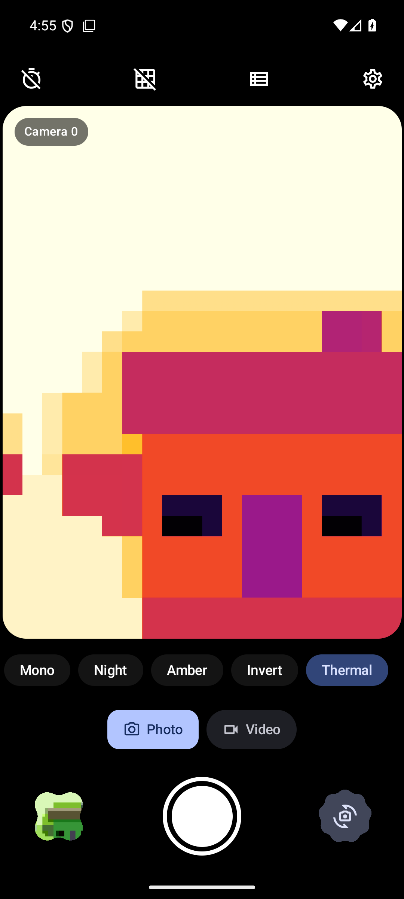
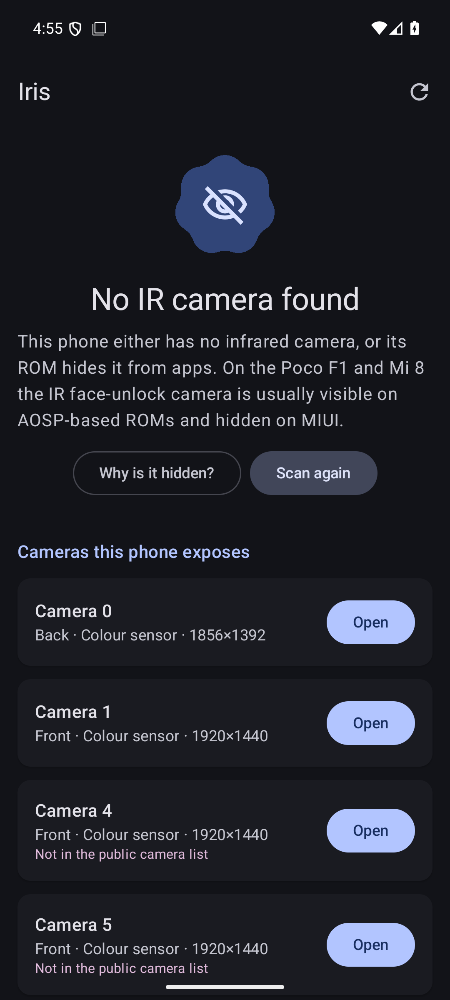
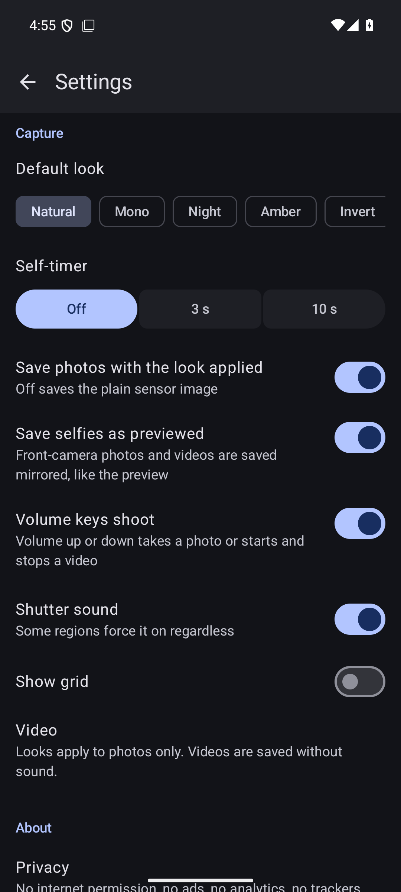
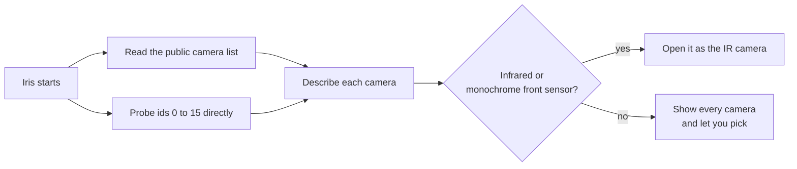

<div align="center">


# Iris

**An infrared camera app for the Poco F1 and Xiaomi Mi 8.**

Iris opens the infrared face-unlock camera as an ordinary camera, so you can see and record
in the dark. No ads, no trackers, no internet permission.

[Download the latest APK](https://github.com/hrmasss/iris-ir-camera/releases/latest)

</div>

<p align="center">

&nbsp;

&nbsp;

</p>

## Features

| | |
|---|---|
| **Finds the IR camera** | Checks hidden camera ids as well as the public list, and picks the infrared sensor automatically |
| **Works on any phone** | Without an IR camera, Iris explains why and lets you use any camera the phone exposes |
| **Photo and video** | Photos as JPEG in `Pictures/Iris`, video in `Movies/Iris` |
| **Looks** | Natural, Mono, Night, Amber, Invert and Thermal (Android 13+) |
| **Selfies as previewed** | Front-camera shots are saved mirrored, like the preview. Can be turned off. |
| **Volume keys** | Volume up or down takes a photo or starts and stops a video. Can be turned off. |
| **The rest** | Pinch to zoom, 3 s and 10 s timer, grid, shutter sound toggle |
| **Design** | Material 3 Expressive, dynamic colour, adaptive and themed icon |

## Supported devices

| Device | Codename | IR camera |
|---|---|---|
| Poco F1 | beryllium | Camera 5 on AOSP-based ROMs (LineageOS, crDroid, Evolution X and similar) |
| Xiaomi Mi 8 | dipper | Camera 5 on AOSP-based ROMs |
| Xiaomi Mi 8 Explorer | ursa | Expected at camera 5, not yet confirmed |
| Other phones | | Iris scans every camera and ranks infrared and monochrome sensors first |

Iris needs Android 10 or newer and targets Android 16.

On stock MIUI the IR camera is usually hidden from apps. See [how IR access works](docs/how-ir-access-works.md).

## Install

1. Download `iris-<version>.apk` from [Releases](https://github.com/hrmasss/iris-ir-camera/releases).
2. Open it on your phone and allow installing from that source.
3. Grant the camera permission when Iris asks.

Each release lists the APK's SHA-256 and the signing certificate fingerprint, so you can check the
file before installing.

## How IR access works



The phone's camera service decides which cameras an app may open. Many ROMs leave the IR sensor
out of the public list but still allow opening it by id, which is why Iris probes ids directly.
The full explanation, including why MIUI hides it, is in
[docs/how-ir-access-works.md](docs/how-ir-access-works.md).

## Privacy

- The only permission is **camera**. Iris has no internet permission, so it cannot send anything anywhere.
- No ads, analytics, crash reporters or trackers.
- Photos and videos are saved through Android's media store. Nothing else leaves the app.

## Build

You need JDK 17 or newer and an Android SDK with platform 37 installed.

```sh
git clone https://github.com/hrmasss/iris-ir-camera.git
cd iris-ir-camera
./gradlew assembleDebug        # app/build/outputs/apk/debug/
```

`./gradlew assembleRelease` signs the APK when the `IRIS_SIGNING` environment variable points at a
properties file with `storeFile`, `storePassword`, `keyAlias` and `keyPassword`. Without it, the
release APK is unsigned.

## Contributing

Bug reports from real devices are the most useful thing right now, especially from ROMs where the IR
camera is not found. See [CONTRIBUTING.md](CONTRIBUTING.md).

## Licence

[Apache-2.0](LICENSE).

## Credits

- Inspired by the "IR camera - Poco F1/Mi8" app. Iris is an independent implementation.
- UI icons are [Material Symbols](https://fonts.google.com/icons) (Apache-2.0).
