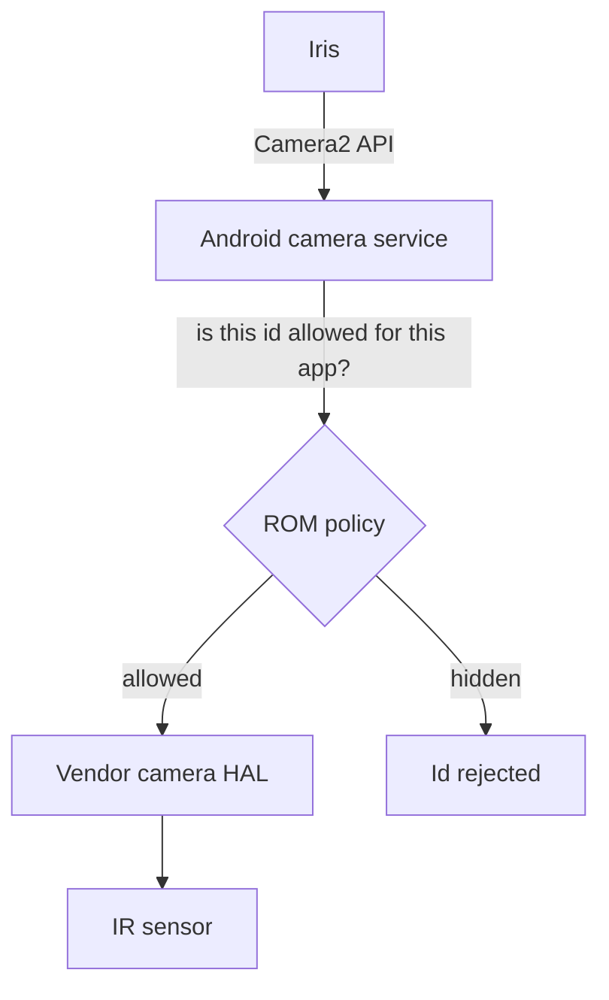
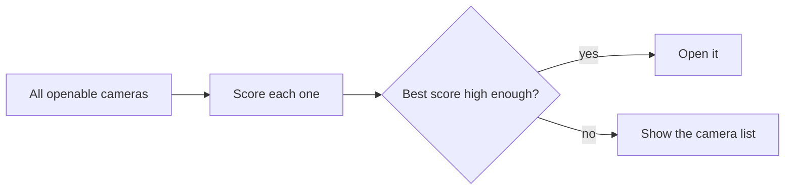

# How IR camera access works

The Poco F1 and Mi 8 unlock with your face using a small infrared camera next to the selfie
camera, plus an infrared light. To Android, that sensor is just another camera with its own id.
Whether an app can open it depends on the ROM.

## The path from app to sensor

| Layer | What it decides |
|---|---|
| Camera2 API | How apps ask for a camera: by a string id such as `"0"` or `"5"` |
| Camera service | Which ids an app may see and open |
| Vendor camera HAL | Which physical sensors exist and how they are numbered |

## Why the IR camera is often missing from the list

Android's public camera list normally shows the main back and front cameras only. Extra sensors
such as depth, macro or infrared are "auxiliary" cameras, and ROMs treat them differently:

| ROM type | Public list | Open by id |
|---|---|---|
| AOSP-based (LineageOS, crDroid, Evolution X, ...) | Usually hidden | Usually allowed |
| Stock MIUI | Hidden | Allowed only for apps on an allowlist |

So asking "which cameras exist?" is not enough. Iris also tries ids 0 to 15 directly, and keeps
every id the camera service will describe.

## How Iris picks the IR camera

| Signal | Why it points to IR | Weight |
|---|---|---|
| Sensor reports a near-infrared colour filter | The camera says so directly (Android 10+) | Highest |
| Known phone and id pair (Poco F1, Mi 8: id 5) | Known layout on AOSP-based ROMs | High |
| Front-facing and monochrome | IR sensors have no colour filter | Medium |
| Front-facing, not in the public list, not colour | Typical of an auxiliary face sensor | Low |

You can always override the choice in Settings, or pick any camera from the list.

## Stock MIUI

Qualcomm-based ROMs, MIUI among them, read a system property named `camera.aux.packagelist`.
Only apps whose package name is in that list can open auxiliary cameras. To use Iris on MIUI,
the property must include `io.github.hrmasss.iris`. People usually set it with a Magisk module,
since changing system properties needs root.

Iris itself never asks for root and never edits system files.

## Light

The IR camera sees infrared light. In complete darkness it needs the phone's IR emitter. On many
ROMs the emitter switches on with the IR camera stream; on others it only runs for face unlock, and
the image then depends on the infrared already around you. Iris does not control the emitter
directly.
